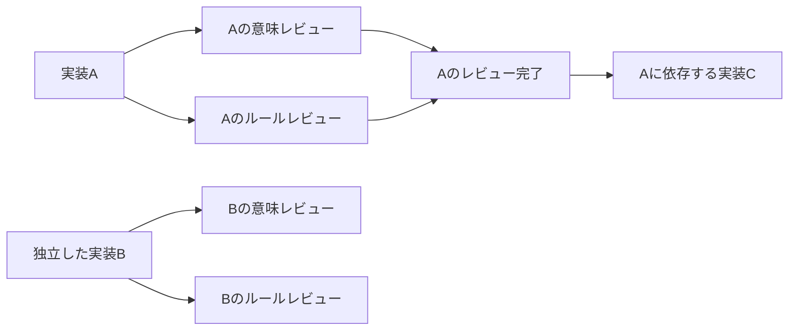

# Copilotの同期・非同期委譲と並列オーケストレーション

2026-10-14。現在の `feat/github-copilot-migration-kit` の実装、各プロンプト、
公式資料、公開ホストソースを調査した。実行コード・プロンプトは変更していない。

## 現実装はmodeを渡しているか

`mode: "sync"` / `mode: "async"` / `mode: "background"` をホストの委譲ツールへ
明示的に渡す実装・プロンプトはない。
nativeは[共通スキル](../../skills/code-migration/SKILL.md#L74)とorchestratorで
「並列に委譲する」と指示しているが、具体的な非同期起動・ハンドル管理・完成順の
結果回収は実装されていない。Copilotのtaskを親が使う場合、その既定のsync呼び出しに
任せる余地がある。実際に親がどの引数を渡したかは実セッションの記録を確認する必要がある。

[native request](../../lib/native-workers.mjs#L111)も、エージェント・モデル・promptは持つが、
ホストの起動modeや子エージェントIDを持たない。
`config.mode` はpreserve/redesignという移植方式で、同期・非同期の指定ではない。

一方、[CLI adapter](../../scripts/copilot_adapter.mjs#L63)は各役を独立したCLIプロセスとして
起動するためtaskのmodeを使わない。`-s` はsilentであり、syncの指定ではない。
JavaScript関数の `async` は、Copilotサブエージェントのbackground起動指定とは別である。

## ホストごとの実行方法

| 経路 | 非同期・並列の方法 | 現状と制約 |
|---|---|---|
| VS Code Copilot（Agent Host）のnative | Copilotランタイムの `task(mode: "background")` を使い、ハンドルと完了結果を管理する | ランタイムと公開ホストソースはbackground subagentを扱う。ただし利用者のホストに公開されたツール定義・引数・モデル情報取得は実機未確認。 |
| VS Code Localのnative | 同じターンで複数の `runSubagent` 呼び出しを発行する | `mode` 引数はない。複数呼び出しは並列に開始できるが、親の次の判断は呼び出し群の結果待ちになる。 |
| 現在の `workerBackend: copilot-cli` | Nodeが複数CLIプロセスを並列に起動する | 既に並列化済み。taskのsync/background指定を追加する場所はない。 |
| Copilot CLIを親オーケストレーターとして使う構成 | `task(mode: "background")`、または親の `/fleet` / `--fleet` | ランタイムの機能。現在のキットのファイルキューとモデル確認・receiptへ接続する手順は追加が必要。 |

Copilotのサブエージェントで非同期起動に使う値は **background**。
シェルツール `bash` / `powershell` の `mode: "async"` や、CLIの
`--mode interactive|plan|autopilot` とは区別する。

根拠：

- [Copilot CLI公式changelog](https://github.com/github/copilot-cli/blob/main/changelog.md)
  の1.0.35は、syncが完了まで待ち、追加入力等には `mode: "background"` を使うと明記。
- [GitHub公式の参考プロンプト](https://github.com/github/awesome-copilot/blob/main/skills/azure-architecture-autopilot/references/phase1-advisor.md#L663)
  も、既定syncとbackgroundの使い分けを記載。これは参考実装であり、全ホストのツールschemaの証明ではない。
- [SDKのFleet説明](https://docs.github.com/en/copilot/how-tos/copilot-sdk/features/fleet-mode)
  は、独立作業のbackground dispatchと依存関係に基づく親の調整を推奨。
- [公開VS Codeホストソース](https://github.com/microsoft/vscode/blob/main/src/vs/platform/agentHost/node/copilot/copilotAgentSession.ts#L2482)
  は `executionMode === 'background'` のagentと、SDKのtasks list・完了イベントを扱う。
- [LocalのrunSubagent](https://github.com/microsoft/vscode/blob/main/src/vs/workbench/contrib/chat/common/tools/builtinTools/runSubagentTool.ts#L50)
  は完了待ち・statelessと説明し、入力はprompt/description/agentName/modelのみ。
  [Copilot拡張のツール処理](https://github.com/microsoft/vscode/blob/main/extensions/copilot/src/extension/prompts/node/panel/toolCalling.tsx#L379)
  は `CoreRunSubagent` を並列起動対象にしている。

同期の呼び出しであっても、同一ターンの複数ツール呼び出しは並列に開始できる。
backgroundの利点は、親が完了を待たずにハンドルを受け取り、別の仕事を進め、
完成した結果から順に回収できることにある。

## 既にある並列処理と、まだない接続

[Node runner](../../lib/pipeline.mjs#L178)には全AI呼び出し共通のsemaphoreがある。
[2種のレビュー](../../lib/pipeline.mjs#L281)は `Promise.allSettled` で起動し、
[複数単位の処理](../../lib/pipeline.mjs#L338)は `Promise.race` で完成した単位から
次の準備済み単位を投入する。
依存元は現在の有効な独立レビューまで完了してから依存先へ進む。
レビューだけを別の上限で追加する構成ではない。

したがって、現在のCLIプロセス方式は「全ファイルを順に実装し、その後全部レビュー」にはなっていない。
defaultの `concurrency: 2` は実装・レビュー・裁定・修正を合計して2件である。
ファイル数の並列上限と各ファイルのレビュー2件を掛け算した値ではない。

nativeでは、親が1件起動するたびに完了を待つとこの並列性が失われる。
同一ターンの並列起動でも、一群の全結果を待ってからまとめてsubmitすると、
早く終わったファイルのレビューや依存先の実装が遅れる。
Node側が非同期でも、親が結果を提出しない間はrunnerの枠が解放されない。

## 効率的な親の実行ループ

既存のrunner・権限分離・receiptを維持し、ホスト接続を次の手順にする。

1. ホストを判別し、実ツールschemaで起動・background・状態取得・結果取得・キャンセル・
   使用モデル確認の能力を調べる。`doctor` の静的検査だけで対応済みとは扱わない。
2. 承認済みの04 runnerを継続ターミナルで起動する。親をターミナルの終了待ちで塞がない。
3. 完了通知や状態取得から完成した子を見つけ、その結果を直ちに該当nativeタスクへ提出する。
   1件の長い子を指定して待ち、他の子の回収が遅れる構造を避ける。
4. `list` のpendingから、空いた枠分だけclaimする。Copilotでは実際のtaskにbackgroundを指定し、
   要求された専用プロファイル・モデル・固定promptで起動する。
5. native task ID、claim token、request hashとホストのagent ID/tool call IDを対応付ける。
   request自体は変更せず、接続用の対応表として別に保持する。
6. 起動受付と完了を区別する。使用モデルを確認し、返ったJSONを変更せずsubmitする。
   起動失敗・不正JSON・モデル確認不能はfailとする。
7. 3〜6をrunner終了まで続け、最後に終了コードと現在のreceiptを確認する。
   pendingが一時的に空になっただけで完了とはしない。

起動の概念例。具体的な引数名・selectorは利用ホストが公開したschemaへ合わせる。

```text
task({
  agent_type: claimed_task.agent_selector,
  mode: "background",
  model: claimed_task.model,
  description: claimed_task.description,
  prompt: claimed_task.prompt
})
```

`agent_selector` / `description` は説明用の名前で、現requestの実フィールドではない。
現requestの `agent` / `agentName` とrole/targetから解決する。
状態・結果は `list_agents` / `read_agent` またはSDKのtasks API・ライフサイクルイベントで取得する。
親プロファイルでは起動だけでなく回収・停止のツールも利用できるか確認する。
`agent` というtool aliasがその全機能を提供すると推定しない。

Localにはこのbackground modeを渡さず、空き枠分のrunSubagentを同じターンで発行する。
標準Localの完成順回収には制約があるため、必要なら非LLMのホスト接続を用意するか、
利用者がCopilot Agent Hostまたは既存CLIプロセス方式を選ぶ。自動では切り替えない。

## 実装とレビューの重ね方

同じファイルは、候補を確定してから固定入力を作り、レビューを開始する。
2種のレビューは並列にする。一方、別ファイルの実装と完成済み候補のレビューは重ねる。



図の並列箇所も全AI共通の枠内で実行する。Aを編集中にAの最終レビューを走らせたり、
片方のレビューだけでAを完了にしたりしない。
両レビューの合流は必要なので、現在の `Promise.allSettled` を最初の1件の成功へ置き換えない。
Nodeだけが対象を書き込み、原本・ルール・judge・設定はrun中に固定する。

Copilot nativeの上限はキット設定と実ホストの許容枠の小さい方に合わせる。
CLIプロセス方式は別セッションを起動するため、同一セッション内subagent上限とは区別する。
公式referenceにはenv変数の32/256と契約別2/4/8/16/32が併記されており、
一つの数字を全ホストへ適用しない。静的な最大値ではなく実際の利用可能枠を確認する。
現在の2から4等への調整は候補になるが、設定・承認・利用者の意向を確認して明示的に行う。
1ファイルしかない場合や依存が完全な一本道なら、mode変更だけで実装自体が短縮するわけではない。

## 各工程への反映候補

00〜06の順序とレビュー境界を維持し、工程の内部だけを並列化する。

| 工程 | 並列にする作業と親の責任 |
|---|---|
| 00 | 原本・環境・移行先の調査を分担し、親がfeasibilityへ統合する。 |
| 00b | 契約・境界条件・シナリオの調査を分担する。親がjudge設計を統合し、source-onlyの選択を尊重する。 |
| 01 | 独立したディレクトリ・モジュールの依存抽出を分担し、親が宣言とmanifestを統合する。 |
| 02 | 数値・文字列・例外等のgap分類を分担する。RULEBOOK/inventoryの更新は親が統合し、承認を確認する。 |
| 03 | A/Bの独立試作を並列にし、両方の結果後に比較する。strict pilotの循環は別途専用経路で解消する。 |
| 04 | background起動・完成順提出・空き枠補充を実行手順として具体化する。 |
| 05・05b・05c | 独立した検証は可能な範囲で並列にするが、同じbuild成果物を変更するコマンドや前工程依存は直列にする。 |
| 06 | 証跡整理・文書案を分担し、親が最後の検証・handoffを確定する。 |

01/02等には現在、ファイル変換runnerのような汎用のphase workerキューがない。
上記は今後の手順・接続の候補であり、既に自動実行されるとは扱わない。
workerのscope、渡す固定入力、返す形式、親の統合責任を各プロンプトへ明記する。
新しいモデル配分や言語別テンプレートをこの変更へ含める必要はない。

[Fleet](https://docs.github.com/en/copilot/concepts/agents/copilot-cli/fleet)は親が独立作業を
分割・調整する仕組みとして参考になる。SDKの `session.rpc.fleet.start` は実験的。
既存の5役ワーカーへ個別に `--fleet` を付ける変更はしない。
ワーカーは再委譲できるtoolsを持たず、親の仕事の範囲・承認・レビュー契約も維持する必要がある。
Fleetを使っても00〜06を自動で通過・承認させない。

## 固定遅延による検証

実runner/nativeキューを使い、固定応答の子を模擬した。
Aの実装100ms、独立Bの実装1800ms、Aに依存するCの実装1200ms、各レビュー50ms。
上限2、3ファイル、9呼び出しを、親の回収方式だけ変えて比較した。

| 模擬した親の方式 | 全体 | 最大同時数 | Aの完成→提出 | Cの開始 |
|---|---:|---:|---:|---:|
| 1件ずつ完了待ち | 3.985秒 | 1 | 2.278→2.290秒 | 2.545秒 |
| 同時起動し一群の全結果後に提出 | 3.646秒 | 2 | 0.174→1.884秒 | 2.261秒 |
| backgroundを模して完成順に提出 | 2.087秒 | 2 | 0.179→0.194秒 | 0.467秒 |

これはキットと固定遅延を用いた回収方針のシミュレーション。
実Copilotツールの呼び出し、実AI、実VS Codeの時間測定ではなく、実案件の加速率は保証しない。
キューの順番・ローカル処理の負荷でも値が変わる。
重要な観測は、一群の完了待ちで早い結果の提出が遅れ、依存先の開始が遅れること。

- [観測値とイベント列](../validation/copilot-parallel-orchestration-2026-10-14.json)
- [再現用の固定応答スクリプト](../validation/copilot-parallel-queue-probe-2026-10-14.mjs)
  は `node docs/validation/copilot-parallel-queue-probe-2026-10-14.mjs` で実行できる。
  使い捨て案件を/tmpに作り、モデルやCopilot CLIは呼ばない。

## 残る検証と優先順

1. Copilot/Localのホスト能力を確認する接続と、モデルメタデータ取得を用意する。
   [前回のモデル確認問題](2026-10-14-sol56-max-review.md)は、background指定だけでは解決しない。
2. Copilot用のbackground dispatcherと、完成順submit・枠補充を作る。
3. Local用の同一ターン並列呼び出しを具体化し、対応する機能・制約を明示する。
4. 各phase promptに並列単位と合流点を記載する。まず04を実ホストで確認する。
5. host spawn/finish、submit、待ち時間、同時稼働数、役割別時間を記録して、
   起動待ち・一群待ち・モデル処理・typecheck・依存待ちを区別する。

実CLI 1.0.95のセッション開始はこの環境の監視資源上限で止まる。
今回も単一 `inotify_init1` がerrno 24になり、[観測JSON](../validation/copilot-parallel-orchestration-2026-10-14.json)
へ保存した。実CLIでのbackground実行やモデルへの要求は行っていない。
実VS Code UIもなく、親に公開されるmode引数・通知・キャンセル等は未検証。

公式ソース取得内容のSHA-256先頭16桁：CLI reference `33388b5358df56a9`、
SDK Fleet `8b69a083738d16f0`、CLI changelog `ea43524a5efc54cc`、
VS Code subagents `09303b64dbc59715`、VS Code harnesses `7f4caa9b6ce602ee`。
